# CryptionChat

**CryptionChat** is a privacy-first, End-to-End Encrypted (E2EE) Android messaging & voice-calling application designed around Zero-Knowledge client-side cryptography, local encrypted storage, Tor proxy support, and active device-level privacy protections.

[](LICENSE)
[-green.svg)](app/build.gradle.kts)
[](build.gradle.kts)
[](https://github.com/puccilorenzo21/CryptionChat/actions/workflows/android-ci.yml)
[](https://github.com/puccilorenzo21/CryptionChat/releases/latest)

<p>
  <a href="https://lollo1344.altervista.org/CryptionChat/CryptionChat.html">
    
  </a>
</p>

> **Attribution Notice:** Everyone is free to use, modify, and redistribute CryptionChat under the **Apache License 2.0**, provided that you **credit the original author — Lorenzo Pucci (puccilorenzo21)** — and preserve the [`LICENSE`](LICENSE) and [`NOTICE`](NOTICE) files. See [License & Attribution](#license--attribution).

---

## Download

- **Pre-built APK**: Download the latest release from [GitHub Releases](https://github.com/puccilorenzo21/CryptionChat/releases/latest) *(or visit the [official website](https://lollo1344.altervista.org/CryptionChat/CryptionChat.html))*.
- **Self-Hosted / Source Build**: See [Quick Start (Build from Source)](#quick-start-build-from-source) below.

## Screenshots

<p align="center">
  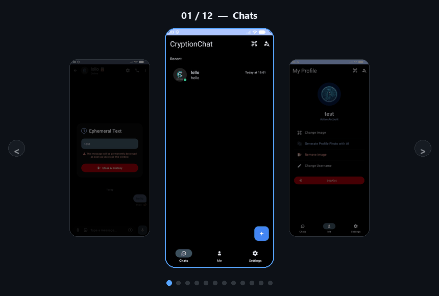
</p>

<details>
<summary>Browse all 12 screenshots individually (in creation order)</summary>

| 01. Chats | 02. My Profile | 03. Settings | 04. Security & Privacy |
| :---: | :---: | :---: | :---: |
| 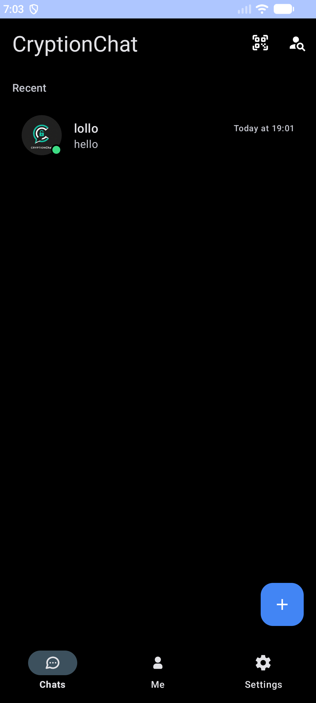 | 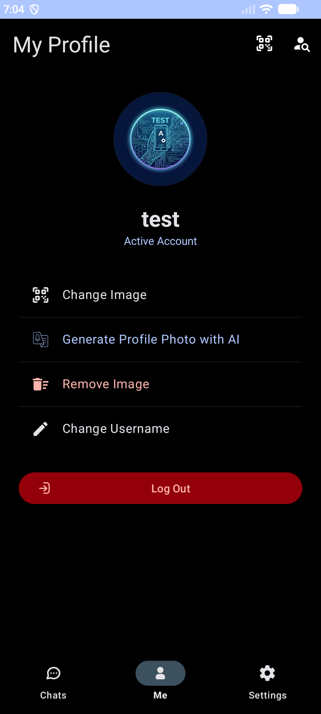 | 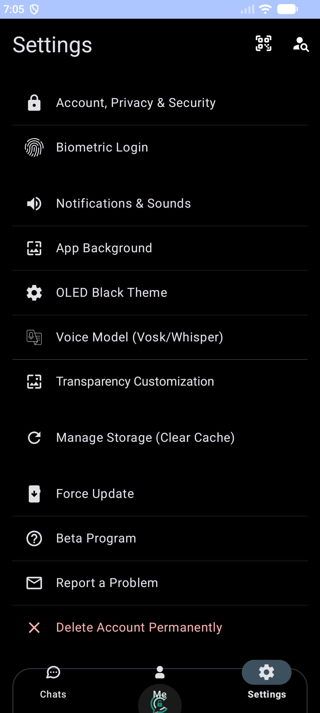 | 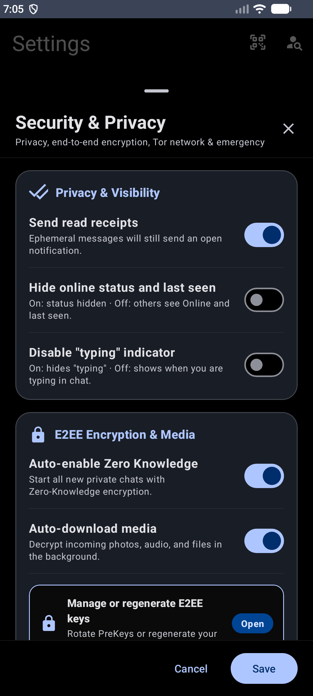 |

| 05. Emergency Triggers | 06. Self-Destruct & Data | 07. Mention Notifications | 08. App Background |
| :---: | :---: | :---: | :---: |
| 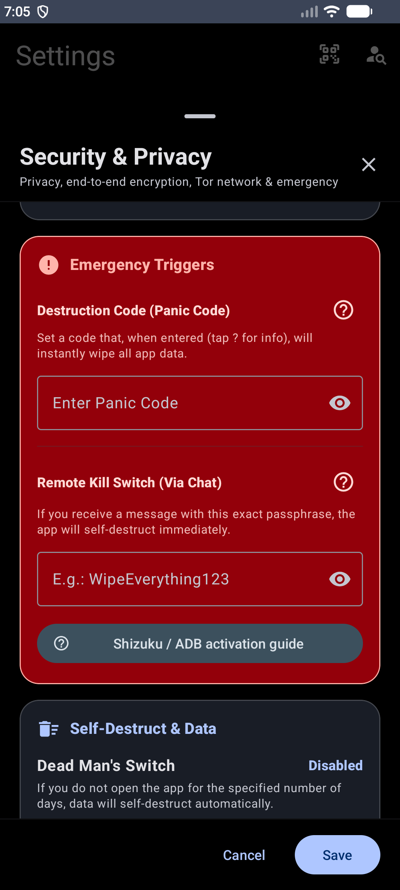 | 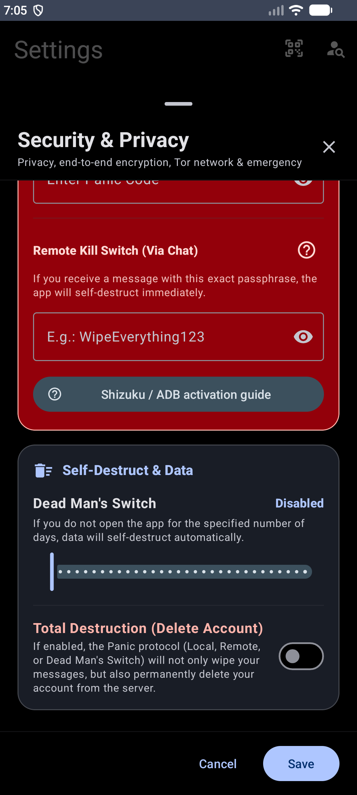 | 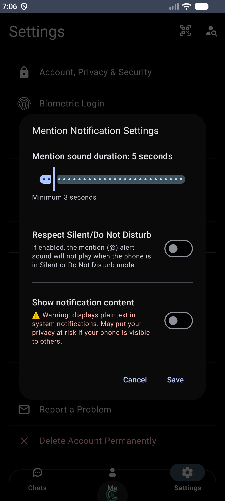 | 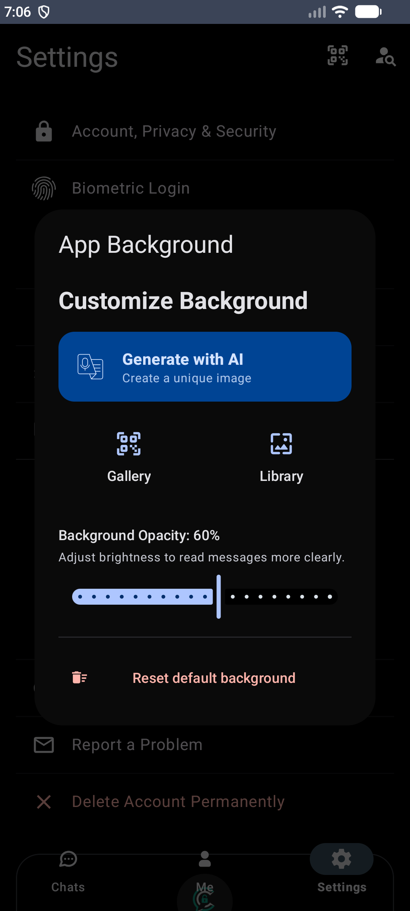 |

| 09. Encrypted Chat | 10. Chat Attachments | 11. Ephemeral Message | 12. Ephemeral Text Viewer |
| :---: | :---: | :---: | :---: |
| 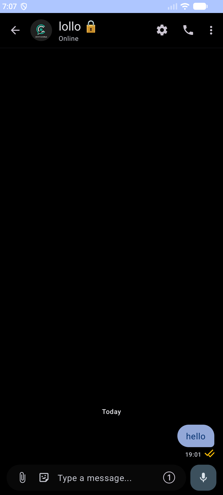 | 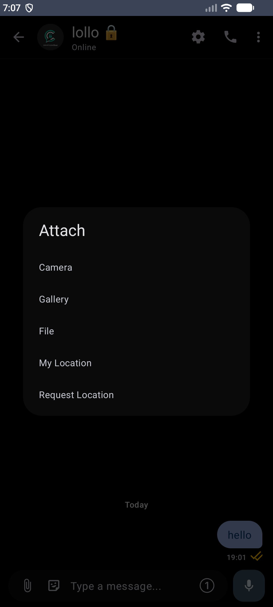 | 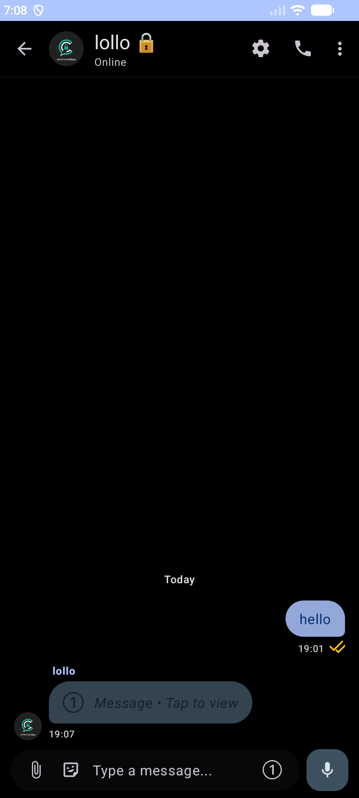 | 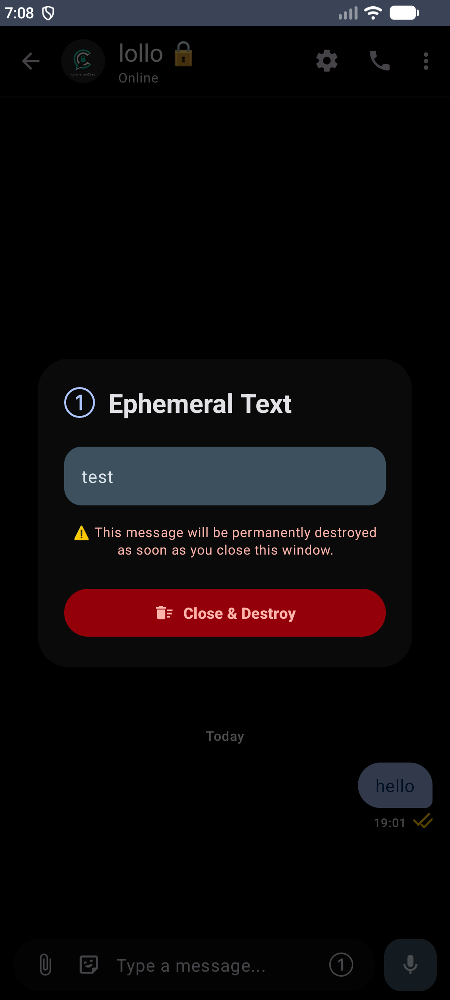 |

</details>

---

## Key Features

- **End-to-End Encryption (1-to-1 & Groups)**
  - **X3DH** (Extended Triple Diffie-Hellman on `secp256r1`) asynchronous session bootstrap (`X3dhHelper.kt`)
  - **Double Ratchet** protocol for forward secrecy and post-compromise security (`DoubleRatchetHelper.kt`, `E2eeSessionOrchestrator.kt`)
  - **Sender Keys** for encrypted group messaging (`SenderKeyHelper.kt`)
  - Identity key verification & QR code trust fingerprints (`IdentityKeyManager.kt`, `QrCodeHelper.kt`)
- **Encrypted Local Persistence**
  - **Room + SQLCipher** (`AppDatabase.kt`) encrypting local messages, Double Ratchet vault, and trusted identities at rest
  - **AndroidX Security Crypto** (`SecurePrefs.kt`) backed by Android Keystore
- **Network Privacy & Transport Security**
  - Optional **Tor SOCKS5** proxy routing via **Orbot** (`OrbotHelper.kt`) with fail-closed DNS/traffic enforcement
  - Unified **OkHttp** stack with **SPKI Certificate Pinning** (`ApiClient.kt`, `SecureGlideModule.kt`)
- **Encrypted WebRTC Voice Calls**
  - P2P/relayed calls using `io.github.webrtc-sdk:android` (`WebRtcClient.kt`, `CallManager.kt`, `MeteredcaManager.kt`)
- **On-Device Offline Voice Transcription**
  - Native **`whisper.cpp`** (`WhisperLib.kt`, `app/src/main/cpp/native-lib.cpp`) and **Vosk** (`AudioTranscriber.kt`) running locally on the device
- **Extreme Privacy & Anti-Forensics Controls**
  - **FLAG_SECURE** & active **Screenshot Detection** (`ScreenshotDestroyer.kt`)
  - **Panic Code** & **Dead Man's Switch** automatic local/remote wipe (`PanicHelper.kt`)
  - **Biometric Lock** (`BiometricHelper.kt`), **Root Detection** (`RootDetectionHelper.kt`), and **Stealth Hide App** Quick Settings tile (`HideAppTileService.kt`)

---

## Project Structure

```text
CryptionChat/
├── .github/
│   ├── ISSUE_TEMPLATE/        # Bug report & feature request templates
│   ├── workflows/             # Android CI workflow (Gradle test & build)
│   └── PULL_REQUEST_TEMPLATE.md
├── app/
│   ├── src/main/
│   │   ├── cpp/               # Native JNI bridge (whisper.cpp + ggml + CMake)
│   │   ├── java/com/lollo1344/cryptionchat/
│   │   └── res/               # Android UI layouts, drawables, IT/EN strings
│   ├── src/test/              # JVM unit tests (crypto, panic, session lifecycle)
│   └── build.gradle.kts
├── docs/
│   ├── screenshots/           # App screenshots & animated carousel
│   ├── ARCHITECTURE.md        # Cryptographic & client module architecture
│   └── SETUP.md               # Build, configuration & placeholder setup guide
├── gradle/wrapper/            # Gradle wrapper
├── CHANGELOG.md
├── CODE_OF_CONDUCT.md
├── CONTRIBUTING.md
├── LICENSE                    # Apache License 2.0
├── NOTICE                     # Mandatory attribution notice
├── SECURITY.md                # Security architecture & disclosure policy
├── keystore.properties.example
├── build.gradle.kts
└── settings.gradle.kts
```

---

## Quick Start (Build from Source)

### Prerequisites
- **JDK 17**
- **Android Studio** (or Android SDK CLI) with **Compile SDK 37**, **Min SDK 29**, and **CMake 3.22.1** + **NDK** installed
- Your own compatible backend endpoint and Metered.ca TURN credentials (placeholders are used in the public open-source distribution)

### Setup Steps
1. Clone the repository:
   ```bash
   git clone https://github.com/<your-username>/CryptionChat.git
   cd CryptionChat
   ```
2. Configure the placeholders before building for your own infrastructure (see [docs/SETUP.md](docs/SETUP.md)):
   - `ApiClient.kt`: set `BASE_URL` (and SPKI pins if applicable)
   - `MeteredcaManager.kt` & `WebRtcClient.kt`: set your Metered.ca TURN/STUN keys
   - `DeviceUtils.kt`: set your own static device salt
3. For signed release builds, copy `keystore.properties.example` to `keystore.properties` and fill in your keystore credentials (never commit `keystore.properties` or `.jks` files).
4. Run unit tests and compile the release APK:
   ```bash
   ./gradlew testDebugUnitTest
   ./gradlew assembleRelease
   ```

For detailed instructions, see [docs/SETUP.md](docs/SETUP.md) and [docs/ARCHITECTURE.md](docs/ARCHITECTURE.md).

---

## License & Attribution

**CryptionChat** is licensed under the **[Apache License, Version 2.0](LICENSE)** with the accompanying **[`NOTICE`](NOTICE)** file.

- **Allowed**: Commercial use, modification, distribution, private use, patent use.
- **Required**: You **must** include the [`LICENSE`](LICENSE) and [`NOTICE`](NOTICE) files and **give clear attribution to the original author** in your repository, documentation, or app credits:

```text
Based on CryptionChat by Lorenzo Pucci (puccilorenzo21)
Licensed under the Apache License, Version 2.0
```

Copyright © 2025-2026 **Lorenzo Pucci (puccilorenzo21)**.
